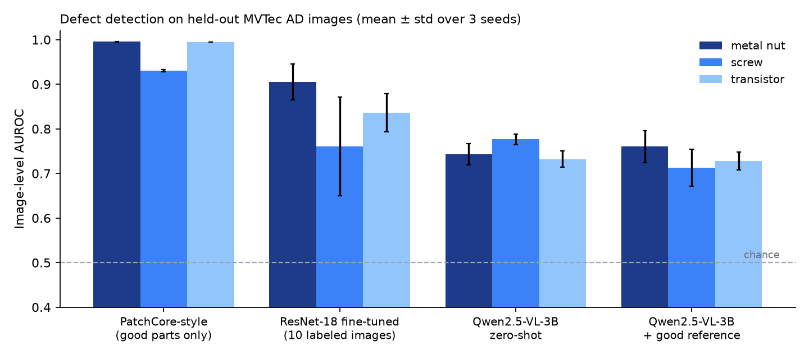

# Defect inspection: anomaly detection vs. transfer learning vs. a vision-language model

**On real factory images from MVTec AD (metal nuts, screws, transistors), a PatchCore-style anomaly detector that learns only from good parts reaches a mean AUROC of 0.974. A ResNet-18 fine-tuned on 10 labeled images reaches 0.834, and the vision-language model Qwen2.5-VL-3B, asked "is this part defective?", reaches 0.751. Showing it a good reference image doesn't help (0.734).** At its default threshold, the VLM calls every part fine. For visual inspection on a production line, the classical detector is the tool; a small general VLM is not, at least without adaptation.

[](https://github.com/dojedaro/vlm-defect-inspection/actions/workflows/ci.yml)
[](https://colab.research.google.com/github/dojedaro/vlm-defect-inspection/blob/main/notebooks/run_experiment.ipynb)



## Results

Image-level AUROC on held-out test images, mean ± standard deviation over 3 seeds (each seed draws
a different set of labeled images; those are removed from that seed's evaluation set for every method).

| Method | What it learns from | Metal nut | Screw | Transistor | **Mean** |
|---|---|---|---|---|---|
| **PatchCore-style** | 213–320 good images, no labels | 0.996 ± 0.000 | 0.931 ± 0.003 | 0.995 ± 0.000 | **0.974** |
| ResNet-18 fine-tuned | 5 defective + 45 good images | 0.905 ± 0.041 | 0.761 ± 0.111 | 0.836 ± 0.043 | 0.834 |
| Qwen2.5-VL-3B, zero-shot | nothing | 0.743 ± 0.024 | 0.777 ± 0.012 | 0.732 ± 0.018 | 0.751 |
| Qwen2.5-VL-3B + good reference | 1 good image | 0.760 ± 0.036 | 0.713 ± 0.042 | 0.728 ± 0.020 | 0.734 |

Evaluation images per seed: metal nut 105 (88 defective), screw 150 (114), transistor 90 (35).

**What a plant engineer would ask: how many defects are caught at a tolerable false-alarm rate?**

| Defects caught when 10% of good parts are flagged | Metal nut | Screw | Transistor |
|---|---|---|---|
| PatchCore-style | **97.7%** | **83.3%** | **100%** |
| ResNet-18 fine-tuned | 76.5% | 36.3% | 54.3% |
| Qwen2.5-VL-3B, zero-shot | 43.6% | 47.1% | 56.2% |

- **The VLM never says "Yes" on its own.** It puts at least 98.7% of its probability on "Yes" or
  "No", so it is answering the question, but P(Yes) never reaches 0.5 (the highest is 0.49). At the natural 0.5 threshold
  it flags 0% of defective parts. Calibrating the threshold on the same 10 labeled images the ResNet
  uses lifts its defect recall to 36–65%, with 4–33% false alarms.
- **It sees obvious damage, not subtle geometry.** By defect type, the zero-shot VLM separates a
  damaged transistor case almost perfectly (AUROC 0.98) but is at chance on bent transistor leads
  (0.47) and upside-down metal nuts (0.54). PatchCore scores 0.87–1.00 on every defect type.
- **Labels are not the bottleneck; the right prior is.** PatchCore uses no defect labels at all and
  wins everywhere. Fine-tuning a classifier on 5 defect examples is noisy (± 0.11 on screws) because
  5 examples cannot cover 4–5 defect types.
- **Cost on a free Colab T4:** the VLM takes 0.3 s per image; PatchCore builds its memory bank and
  scores a part's whole test set in 25–48 s; each ResNet fine-tune takes about 5 s.

## Where a VLM does fit

The VLM is the weakest *detector* here, but it is the only method that can say *what* is wrong in
words and take instructions without retraining. In a deployment I would use PatchCore as the
detector and a VLM downstream: describe the defect on images PatchCore flags, route them, or draft
the inspection report. That split is the next experiment, along with a larger VLM (7B in 4-bit) and
pixel-level localization.

## Fairness: what each method sees

| | Defect-free images | Labeled defects | Notes |
|---|---|---|---|
| PatchCore-style | all training images of the part (213–320) | 0 | WideResNet-50 layer 2+3 patch features, full memory bank, 224 px |
| ResNet-18 fine-tuned | 5 labeled + 40 training images | 5 | ImageNet weights, all layers, class-weighted loss, 15 epochs, no flip augmentation (a flipped metal nut *is* a defect) |
| VLM zero-shot | 0 | 0 | Prompt names the part and lists generic defect words; fixed before any evaluation |
| VLM + reference | 1 random training image | 0 | Same prompt, reference image shown first |

The VLM's decision threshold, when one is needed, is set on the same 10 labeled images the ResNet
trains on; nothing is tuned on evaluation images.

## How it works

```mermaid
flowchart LR
    M[MVTec AD<br/>metal nut, screw, transistor] --> S[Per seed: hold back 5 good +<br/>5 defective test images]
    S --> P[PatchCore-style<br/>good training images only]
    S --> F[ResNet-18 fine-tune<br/>on the 10 held-back + 40 good]
    S --> V[Qwen2.5-VL-3B<br/>P&#40;Yes&#41; to 'is it defective?']
    P & F & V --> E[Same evaluation images:<br/>AUROC, recall at fixed false alarms,<br/>per defect type]
```



- [`data.py`](src/inspect_vlm/data.py): downloads only the needed images from a Hugging Face mirror
  of MVTec AD, checks image counts, and makes the labeled-shot / evaluation split per seed.
- [`methods.py`](src/inspect_vlm/methods.py): the three detectors. The VLM is scored by the
  probability of answering "Yes" (summed over "Yes"/"yes"/" Yes") against "No", at a fixed 448×448
  input, with a guard that stops on non-finite fp16 logits.
- [`run.py`](src/inspect_vlm/run.py): runs everything, computes AUROC with bootstrap intervals, recall
  at 5% and 10% false alarms, per-defect-type AUROC, and VLM decisions at 0.5 and at a threshold
  calibrated on the labeled shots. All per-image scores are in [`results/scores.csv`](results/scores.csv).

## Run it

```bash
pip install -e ".[dev]" && pytest                      # CPU: split, metrics and prompt tests
pip install -e ".[gpu]"                                 # needs a CUDA GPU for the VLM
python -m inspect_vlm.run --data data --out results     # about 25 minutes on a T4
python -m inspect_vlm.report --results results
```

Or open the notebook with the Colab badge. `--no-vlm` runs only the CNN methods.

## Limitations

- **Three parts, image level only.** MVTec AD has 15 categories and pixel masks; localization is
  not evaluated here.
- **One small VLM, one prompt.** Qwen2.5-VL-3B with a fixed generic prompt. Larger VLMs or prompts
  that describe each defect type would likely do better; that would need a held-out set to choose
  the prompt fairly. MVTec AD is public, so the VLM may have seen these images in pre-training.
- **Few evaluation images of good parts** (17–55 per part per seed), so AUROC intervals are wide for
  the weaker methods; per-image scores are saved for any re-analysis.
- **PatchCore is simplified:** no greedy coreset, a single 224 px resolution, which limits the small
  defects on screws.

## Data

[MVTec AD](https://www.mvtec.com/company/research/datasets/mvtec-ad) (Bergmann et al., CVPR 2019),
via the Hugging Face mirror `Voxel51/mvtec-ad`, license CC BY-NC-SA 4.0 (non-commercial). Images are
downloaded at run time and not redistributed here.

## Stack

Python, PyTorch, torchvision, Hugging Face Transformers (Qwen2.5-VL), scikit-learn, pandas,
Matplotlib; pytest and ruff in CI.

## License

MIT (code). The MVTec AD images keep their own license.
